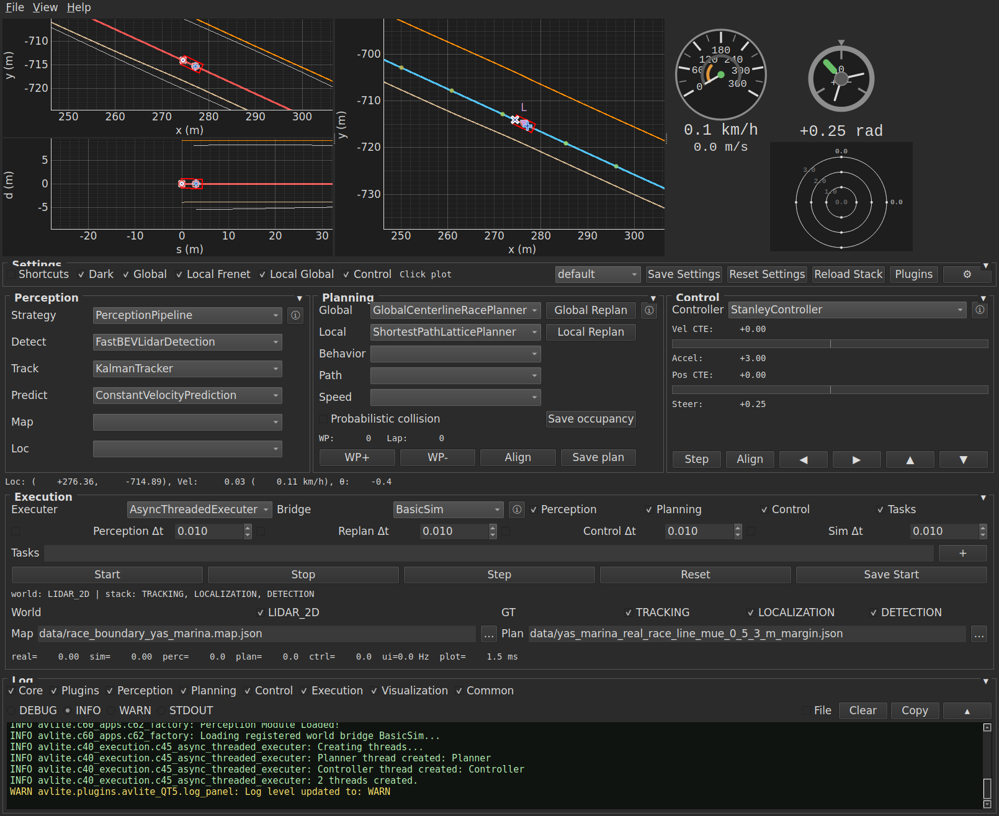
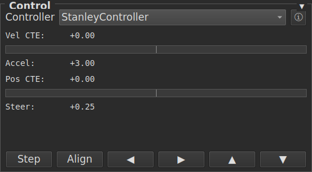
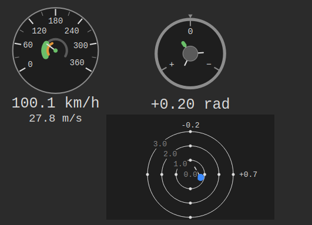
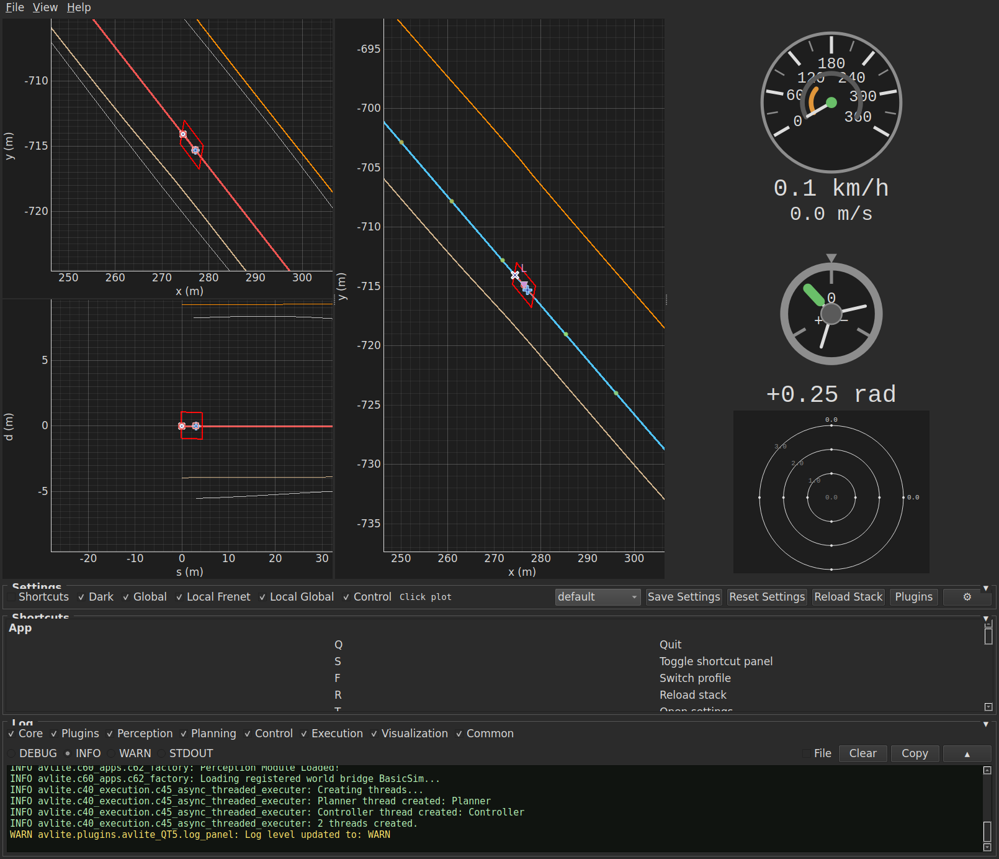
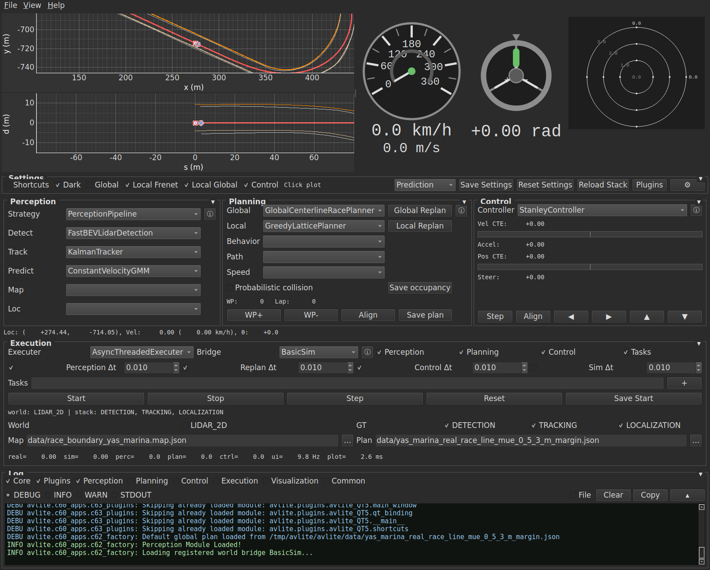
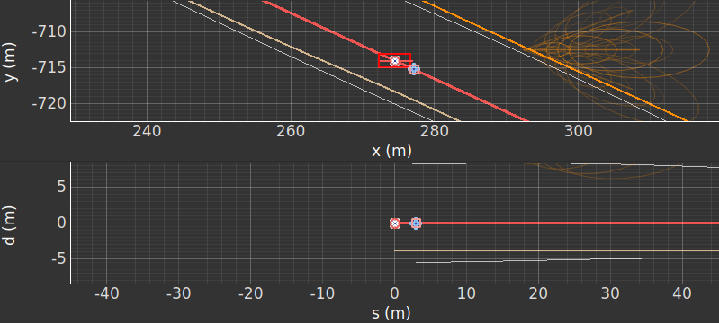
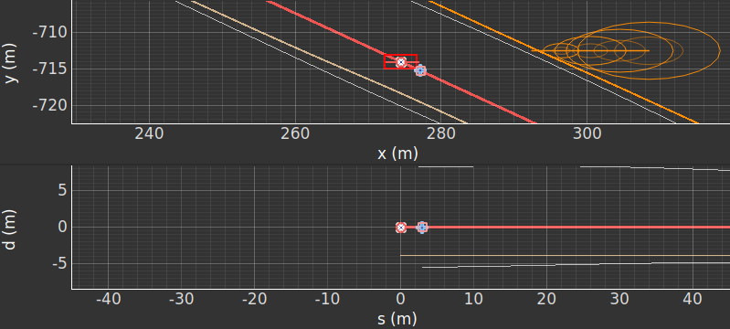

# avlite-QT5

Qt5 visualizer for [AVLite](https://github.com/AV-Lab/avlite). Same BasicSim workflow as the built-in Tk app (map, vehicle, plans, trajectories, stack controls, profiles), drawn with **pyqtgraph** instead of Matplotlib.

**Registry name:** `avlite-QT5`  
**Category:** `AppStrategy` (`cli_name = "qt5"`)

## Why PyQt5

AVLite supports Python 3.10+. PySide2 has no Python 3.12 wheels. PyQt5 5.15.x publishes `cp38-abi3` wheels and is the Qt5 binding pyqtgraph supports. Plots use `PlotDataItem.setData` (OpenGL when a display is available). Simulation and planning run in `exec.step` / `AsyncThreadedExecuter`, not inside the plot refresh timer.

## Install

Requires AVLite 0.6.7 or newer (`avlite` `dev` is the branch this plugin tracks). `requirements.txt` pins `avlite>=0.6.7` and does not cap newer releases.

```bash
pip install -r requirements.txt

git clone https://github.com/rsi-lab/avlite-QT5.git \
  ~/.local/share/avlite/plugins/avlite-QT5
```

Register it like any other community plugin (Plugins browser, or the profile snippet below). AVLite imports the directory as `avlite.plugins.avlite_QT5`. That import does not load PyQt.

Plugin settings are stored under `plugins.avlite_QT5` (the import name, with the dash turned into an underscore). The registry id in `c62_community_plugins` stays `avlite-QT5`.

## Tk visualizer while this plugin is installed

`avlite` builds its Matplotlib figures with `plt.subplots` before it imports community plugins. Once PyQt5 is installed, Matplotlib's automatic backend is `qtagg`, so that call opens a Qt application during the Tk loading screen. Pin the Tk backend in the environment before Python starts:

```bash
MPLBACKEND=TkAgg avlite
```

This repository cannot set that itself. Registered plugins are imported later, from `reload_stack`.

## Launch

The app registers as `qt5`. AVLite 0.6.7 loads `configs/apps.yaml` before it parses subcommands, so once that file points at this checkout:

```bash
avlite qt5
avlite qt5 --profile default
```

`python -m avlite.plugins.avlite_QT5` still works, including `QT_QPA_PLATFORM=offscreen`.

```yaml
c69_apps:
  c62_community_plugins:
    avlite-QT5: avlite-QT5
plugins:
  avlite_QT5:
    p60_dark_mode: true
    p60_use_opengl: true
    p67_show_control_view: true
```

This repository ships [avlite-QT5.yaml](avlite-QT5.yaml). On Install/Update, AVLite can import that file as a profile named `avlite-QT5`.

The dev branch of AVLite ships a `configs/apps.yaml` entry named `avlite-QT5` that points at a local path on another machine. Registering this plugin does not replace an existing key, so `avlite qt5` stays missing until that line is the real checkout.

Plot mouse matches the Tk visualizer. The pyqtgraph right-click menu is disabled. OpenGL stays the default (`p60_use_opengl`); set `AVLITE_QT_NO_OPENGL=1` for a software surface.

- Global plot: left click teleports, left drag sets heading, Ctrl+left drag pans, wheel zooms, right click sets start then goal and replans.
- Local XY / Frenet: left click teleports, right click spawns an NPC, drag sets heading, wheel zooms that pane.
- The Settings bar (profile, Shortcuts / Dark / Global / Local Frenet / Local Global / Control, Save, Reset, Reload Stack, Plugins, gear) sits between the plots and the stack panels.
- The log panel shows live output with Core, Plugins, Perception, Planning, Control, Execution, Visualization, and Common filters, plus level, File, Clear, and Copy.

Shortcut letters match Tk: `S` / `R` / `T` / `E` / `L` / `Q` are the shifted keys. `r` replans, `n` / `b` step the plan waypoint, `t` resets execution, `a`/`d` steer until release.

## Layout

Same shape as [avlite-bridge-carla](https://github.com/AV-Lab/avlite-bridge-carla): repository root is the plugin package (`__init__.py`, `settings.py`, strategies, `requirements.txt`, `<name>.yaml`, `README.md`, `test/`).

## Feature parity with the Tk visualizer on AVLite `dev`

Headless check: `QT_QPA_PLATFORM=offscreen AVLITE_QT_NO_OPENGL=1 python3 -m pytest test -q`

| Feature | Tk dev | Qt5 before | Qt5 after |
|---|---|---|---|
| App command, community import, no Qt at import | `avlite` Tk app | `qt5`, lazy Qt import | same, targets AVLite ≥ 0.6.7 |
| BasicSim Yas Marina: ego, plans, boundaries, lattice, predictions, occupancy, lidar, clusters | yes | yes | yes. GMM and GP use the Tk polylines and 50%/95% rings |
| HD-map hover and raceline speed hover | yes | yes | yes |
| Exec start/stop/step/reset, tasks, pace, capability filters, probabilistic collision, save plan/occupancy/start pose | yes | yes | yes. Step passes `localization_dt` |
| Keyboard and mouse, including plan step `n` / `b` | yes | `n` / `b` did not move the waypoint | `n` / `b` call the planner step |
| Control panel: CTE bars, Step, Align, steer and accel buttons. No speed or steer dials in the panel | yes, after the control-plot change | dials still in the panel, WASD labels, side-by-side CTE | one column, arrow buttons, dials removed |
| Control plot: speed (km/h and m/s, accel arc), steer wheel, g-g trail | yes | missing | third pane. Circles share a size and wrap when that makes them larger |
| Show/hide plots, including Control, and sash fractions | `p67_plot_visible`, `p67_plot_sashes` | Global / Local only | Control checkbox plus `p67_plot_sashes` for the three panes |
| Manual drive updates `controller.cmd` so the gauges follow | yes | gauges ignored the command | `applied_cmd` and `controller.cmd` |
| Settings window and profile note when the profile changes | yes | visualizer block stayed on schema defaults, so zoom and open plots did not follow the profile | loads `plugins.p60_visualizer_tk`, then a Qt section if one was saved. Stack rebuilds. Note popup only when the profile actually changes and the note is non-empty |
| Plugin browser | registry columns, install, add to profile, uninstall, update, device login, details | lists registered paths | same columns and the same `_PluginOperations` actions. Member sign-in uses `_GitHubClient` (no public wrapper). Details render the README with Qt markdown |
| Log filters, File and Help menus | yes | yes, plus a View menu | same |
| OpenGL plots | Matplotlib | pyqtgraph, `p60_use_opengl` default on | unchanged |
| Separate World Bridge panel | yes, foldable | bridge, contract, and capabilities live in Execution | left in Execution |
| Third-party `PlotStrategy` panes | yes (`ttk.Frame`) | no | not hosted |
| Mini-map | none | none | none. The global plot is the map |

Left out on purpose:

- `PlotStrategy` panes are Tk frames, so this window cannot embed them.
- The World Bridge block stays inside Execution. The bridge combo, contract button, and capability checks are already there.
- Tk DPI scaling, ttk themes, and the Matplotlib blit cache have no Qt equivalent.
- Copying ROS fields into the ROS plugin's own YAML stays in the Tk app.

## Screenshots

BasicSim on Yas Marina, offscreen. The control plot is the right-hand pane.









The Prediction profile hides the global plot, opens local XY at zoom 170, and selects ConstantVelocityGMM.



GMM draws one solid polyline per mode (opacity is the mode weight) and unfilled 50% and 95% rings about every half-second. GP draws the mean the same way, with one pair of rings. Both match the Tk painter on the same BasicSim agent.





## Tests

```bash
QT_QPA_PLATFORM=offscreen python3 -m pytest test -q
```

## License

MIT, same as AVLite. PyQt5 is GPL/commercial from Riverbank; use a compatible distribution or a commercial PyQt license if you ship a closed product.
