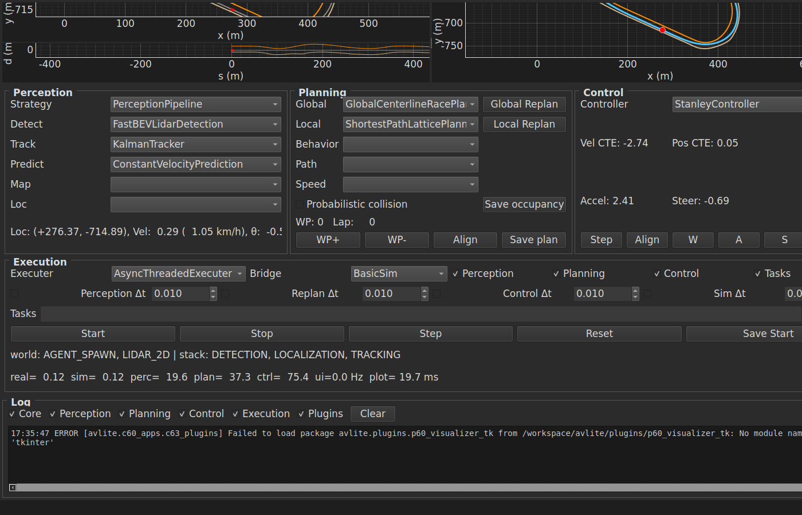
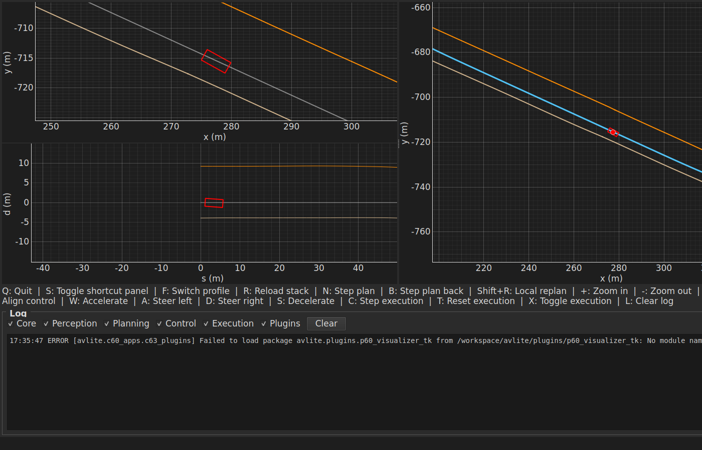

# avlite-QT5

Qt5 visualizer for [AVLite](https://github.com/AV-Lab/avlite). Same BasicSim workflow as the built-in Tk app (map, vehicle, plans, trajectories, stack controls, profiles), drawn with **pyqtgraph** instead of Matplotlib.

**Registry name:** `avlite-QT5`  
**Category:** `AppStrategy` (`cli_name = "qt"`)

## Why PyQt5

AVLite supports Python 3.10+. PySide2 has no Python 3.12 wheels. PyQt5 5.15.x publishes `cp38-abi3` wheels and is the Qt5 binding pyqtgraph supports. Plots use `PlotDataItem.setData` (OpenGL when a display is available). Simulation and planning run in `exec.step` / `AsyncThreadedExecuter`, not inside the plot refresh timer.

## Install (stock AVLite, no core changes)

```bash
pip install avlite
pip install -r requirements.txt

git clone https://github.com/rsi-lab/avlite-QT5.git \
  ~/.local/share/avlite/plugins/avlite-QT5
```

Register it the same way as other community plugins (Plugins browser **Register**, or the profile snippet below). AVLite imports the directory as `avlite.plugins.avlite_QT5` via `CommunityPluginFinder`.

```yaml
c69_apps:
  c62_community_plugins:
    avlite-QT5: avlite-QT5
```

This repository ships [avlite-QT5.yaml](avlite-QT5.yaml). On Install/Update, AVLite can import that file as a profile named `avlite-QT5`.

## Launch

Built-in `p60_*` packages are the only apps imported before `avlite` parses subcommands, so a community `AppStrategy` is started with:

```bash
python -m avlite.plugins.avlite_QT5
QT_QPA_PLATFORM=offscreen python -m avlite.plugins.avlite_QT5 --offscreen
```

## Layout

Same shape as [avlite-bridge-carla](https://github.com/AV-Lab/avlite-bridge-carla): repository root is the plugin package (`__init__.py`, `settings.py`, strategies, `requirements.txt`, `<name>.yaml`, `README.md`, `test/`).

## Feature-parity checklist (Tk visualizer vs this app, BasicSim)

Headless tests: `QT_QPA_PLATFORM=offscreen python3 -m pytest test/test_feature_parity.py -q`

| Feature | Status |
|---|---|
| Registers `AppStrategy` cli `qt` via community import | pass |
| BasicSim stack (default profile) | pass |
| Global plot: ego marker + raceline | pass |
| Global plan left/right boundaries | pass |
| Local XY ego bounding box | pass |
| Local Frenet reference path | pass |
| Execution Step advances sim time (SyncExecuter) | pass |
| Start / Stop | pass |
| Reset returns to start pose | pass |
| Teleport ego (plant + stack PM) | pass |
| Spawn NPC agent | pass |
| Switch controller (Stanley) | pass |
| Switch executer (Sync) | pass |
| Perception pipeline refresh | pass |
| Local replan | pass |
| Waypoint step / step back | pass |
| Align plan to ego | pass |
| Align control (snap ego to plan, reset controller) | pass |
| Control step + accel/steer gauges | pass |
| Manual drive (accel/steer, WASD) | pass |
| Save global plan JSON | pass |
| Save occupancy map (no-op when none) | pass |
| Save start pose into the profile | pass |
| Reload with default global plan path | pass |
| World / stack capability filters | pass |
| Probabilistic collision checkbox | pass |
| Shortcut mode hides stack panels | pass |
| Show/hide global and Frenet views | pass |
| Dark / light theme | pass |
| Log panel append + clear | pass |
| LiDAR overlay after a sim step | pass |
| Plot latency recorded and under 500 ms | pass |
| `python -m avlite.plugins.avlite_QT5` resolves the app | pass |

Not identical to Tk (called out so the checklist stays honest):

- Full schema settings window, plugin browser, and pip update toast stay in the Tk app (`avlite setting`, `avlite plugins`). This app loads/switches profiles and reloads the stack.
- HD-map hover of nearest road/lane is drawn when an HD planner is selected; the default BasicSim profile is a race map.
- Matplotlib-style distance ruler is omitted; zoom, pan, teleport, and NPC spawn are implemented on the pyqtgraph views.

## Screenshots

Offscreen renders against BasicSim (Yas Marina):





## Tests

```bash
QT_QPA_PLATFORM=offscreen python3 -m pytest test -q
```

## License

MIT, same as AVLite. PyQt5 is GPL/commercial from Riverbank; use a compatible distribution or a commercial PyQt license if you ship a closed product.
